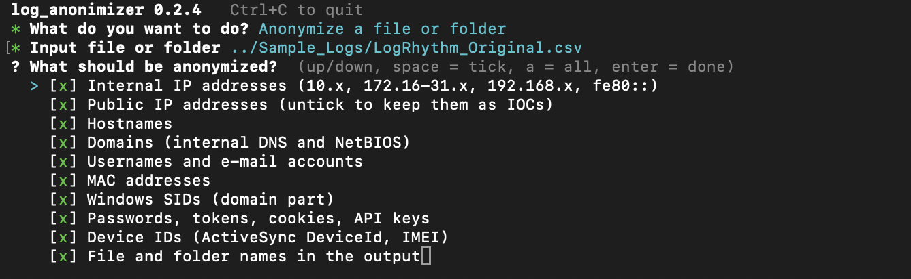

# Log Anonimizer

Replace IPs, hostnames, accounts, domains, e-mails, MACs, SIDs and secrets in logs with tokens
(`HOST_0001`, `USER_0003`, `IP_0012`) before sharing them. Restore the real values later with
the map file you keep.


- The map is encrypted (AES-256-GCM + Argon2id).
- Every run checks that no real value is left.

```
before:  Oct 10 08:15:02 fw-edge01 sshd[2211]: Accepted password for somchai.k from 203.0.113.45
after:   Oct 10 08:15:02 HOST_0001 sshd[2211]: Accepted password for USER_0001 from EXTIP_0001
```


## How it is used

1. Run `-a` on the logs. You get the anonymized logs and a map (`*.anonmap`).
2. Share the anonymized logs with a vendor, a partner or an AI assistant.
   **Never share the map:** it turns every token back into the real value.
3. Get their report back and run `-d` on it: the tokens become the real names again.

## Install

### Download

Get the file for your system from the [latest release](https://github.com/finnvle/Log-Anonimizer/releases/latest):

| File | For |
|---|---|
| `log_anonimizer_<version>_windows_amd64.exe` | Windows 10/11, Server 2016+ |
| `log_anonimizer_<version>_windows_arm64.exe` | Windows on ARM |
| `log_anonimizer_<version>_linux_amd64` / `_linux_arm64` | Linux |
| `log_anonimizer_<version>_darwin_arm64` / `_darwin_amd64` | macOS Apple Silicon / Intel |

Rename it to `log_anonimizer` (`log_anonimizer.exe` on Windows): the commands below use that name.

### Build from source

Needs [Go](https://go.dev/dl/) 1.26+:

```bash
git clone https://github.com/finnvle/Log-Anonimizer.git
cd Log-Anonimizer
go build -o log_anonimizer ./cmd/log_anonimizer   # this machine

# Build for all platforms into dist/
./scripts/build.sh

# Run the tests
go test ./...
```
## TUI Usage (Easier)

```
./log_anonimizer
```




## CLI Usage

```
./log_anonimizer -h
./log_anonimizer -a export.csv    # anonymize  -> export.anon.csv + export.anonmap
./log_anonimizer -d export.anon.csv   # restore -> export.restored.csv
./log_anonimizer -show export.anon.csv    # which token is which real value
./log_anonimizer -verify export.anon.csv -m export.anonmap   # check before sharing
```

`-a` and `-d` also take a folder (e.g. a KAPE triage). `-d` works on any text with tokens,
such as a report you got back. Which files work: [Supported files](#supported-files).

### Windows (PowerShell)

```powershell
Get-ChildItem log_anonimizer_*_windows_*.exe | Rename-Item -NewName log_anonimizer.exe
Unblock-File .\log_anonimizer.exe          # if SmartScreen blocks it
.\log_anonimizer.exe -a export.csv -p acme
.\log_anonimizer.exe -d export.anon.csv
.\log_anonimizer.exe -show export.anon.csv
```

### Linux

```bash
mv log_anonimizer_*_linux_* log_anonimizer
chmod +x log_anonimizer
./log_anonimizer -a auth.log -p acme
./log_anonimizer -d auth.anon.log
```

### macOS

```bash
mv log_anonimizer_*_darwin_* log_anonimizer
chmod +x log_anonimizer
xattr -d com.apple.quarantine log_anonimizer    # if Gatekeeper blocks it
./log_anonimizer -a export.csv -p acme
./log_anonimizer -d export.anon.csv
```

### Passphrase

You create a passphrase when the profile has `encrypt_map: true` (the default), or when you answer Yes in the TUI.

```
...
* Protect the map with a passphrase? Yes (recommended)
* Map passphrase ********
* Repeat passphrase ********
```

`-d`, `-show` and `-verify` ask for it again. If you forget it, the map cannot be opened.
For scripts only, where nobody can type, put it in the `LOGANON_PASSPHRASE` environment variable.

### Options

| Command | |
|---|---|
| `-a <file\|folder>` | anonymize |
| `-d <file\|folder>` | restore the real values (uses the map next to it, or `-m`) |
| `-show <map\|file\|folder>` | which token is which real value |
| `-verify <file\|folder>` | check anonymized output; add `-m` to look for every known value |


| Optional | |
|---|---|
| `-o <path>` | output file or folder (default: next to the input) |
| `-m <map>` | map to use; with `-a`, an existing map is extended (same tokens as before) |
| `-p <profile>` | profile name or `.yaml` file (default: `default`) |
| `-find <text>` | with `-show`: only matching tokens or values (also shows secrets) |
| `-f` | overwrite existing output and map |
| `-q` | no progress messages |
| `-no-encrypt` | plain map (not recommended) |
| `-profiles` | list your profiles with their main settings |
| `-version` | print the version |
| `-h` | help |


## Supported files

Any text file works, with any extension or none: the tool looks at the content, not the name.
Give `-a` a folder and it reads every file in it, subfolders included.

| Log type | Typical files | Read by |
|---|---|---|
| Plain text, application logs | `.log`, `.txt`, `.out`, no extension | line |
| Syslog (RFC 3164 / 5424) | `messages`, `secure`, `auth.log` | line; the host in the header becomes `HOST_…` |
| CSV / TSV exports | `.csv`, `.tsv` | column name: LogRhythm, EvtxECmd (incl. `Payload`), `Computer`, `UserName`, `SourceIP`, … |
| IIS / W3C | `u_ex*.log` | the `#Fields:` line (`c-ip`, `cs-username`, …) |
| Windows event XML | `.xml` (e.g. `wevtutil qe … /f:xml`) | `<Computer>`, `<Data Name='TargetUserName'>`, … |
| JSON, JSON lines | `.json`, `.jsonl`, `.ndjson` | key: `"user"`, `"host"`, `"src_ip"`, … |
| key=value | firewall, CEF, Windows text exports | key: `src=`, `suser=`, `shost=`, `Account Name:`, … |

IPs, e-mails, SIDs, MACs, user paths and your `sensitive_terms` are found in every type, wherever they appear.
CSV keeps its quoting and line endings.

**Encoding:** UTF-8 (with or without BOM) and UTF-16 (PowerShell and many Windows exports).
UTF-16 files are written as UTF-8 with a BOM.

**Binary files are not read.** A single binary file stops with an error. In a folder they are
skipped, left out of the output and listed in `ANONYMIZATION_REPORT.txt`. Convert them first:

| File | Convert with |
|---|---|
| `.evtx` | [EvtxECmd](https://ericzimmerman.github.io/) → CSV |
| Registry hives (`NTUSER.DAT`, `SYSTEM`, …) | RECmd → CSV |
| `$MFT`, `$J` | MFTECmd → CSV |
| `.zip`, `.gz`, `.7z` | extract first |
| `.xlsx` | save as CSV |

## Profiles

The first `-a` run creates **`default.yaml`**
and uses it whenever `-p` is not given, with a yellow warning:

```
! no -p given: created and using the default profile ~/.config/log_anonimizer/profiles/default.yaml
! no sensitive_terms in the profile: your organisation's names in URLs and text may stay visible
```

The default replaces everything and encrypts the map. **Add your organisation's names to
`sensitive_terms`.** It is the one thing the tool cannot guess:

```yaml
sensitive_terms: [acme, acme.co.th]
anonymize:
  public_ip: false   # keep attackers' IPs as IOCs
```

Save a profile per customer as `acme.yaml` in the profile folder (copy `default.yaml`) and run
with `-p acme`. A profile kept somewhere else works with its path: `-p ./acme.yaml`.
Every option is explained in the comments inside `default.yaml`.

`-profiles` shows what each profile does:

```
$ log_anonimizer -profiles
profiles in ~/.config/log_anonimizer/profiles
  default  sensitive_terms: (none)            public IPs: hidden  map: encrypted
  acme     sensitive_terms: acme, acme.co.th  public IPs: kept    map: encrypted
```

Profile folder: `%AppData%\log_anonimizer\profiles` (Windows),
`~/.config/log_anonimizer/profiles` (Linux), `~/Library/Application Support/log_anonimizer/profiles` (macOS).

## Example

[`examples/`](examples) is fictional data with [`profile.yaml`](examples/profile.yaml) (`sensitive_terms: [acme]`):

| File | |
|---|---|
| [`sample.log`](examples/sample.log) | input |
| [`sample.anon.log`](examples/sample.anon.log) | after `-a` |
| [`sample.restored.log`](examples/sample.restored.log) | after `-d`, identical to the input |
| [`show.txt`](examples/show.txt) | `-show sample.anon.log` |
| [`sample.anonmap`](examples/sample.anonmap) | the map, unencrypted so you can read it |
| [`sample.encrypted.anonmap`](examples/sample.encrypted.anonmap) | the same map encrypted, as real maps are; passphrase `example-passphrase` |

Try the encrypted one; it asks for the passphrase:

```
cd examples
log_anonimizer -show sample.anon.log -m sample.encrypted.anonmap
log_anonimizer -d sample.anon.log -m sample.encrypted.anonmap -o restored.log
```

A LogRhythm CSV export after `-a`: addresses and hostnames become tokens, the columns stay as they were.


### Search the map

```
$ log_anonimizer -show sample.anon.log -find somchai
HOSTNAMES
  HOST_0003  WS-SOMCHAI01  3×
USERS
  USER_0001  somchai.k     6×
```

## What is replaced

| | Example | Token |
|---|---|---|
| IP (internal / public) | `10.1.2.3`, `203.0.113.5` | `IP_0001`, `EXTIP_0001` |
| Host, internal FQDN | `DC01`, `dc01.corp.acme.example`, `Server=sql01;` | `HOST_0001`, `HOST_0001.DOMAIN_0001` |
| Account, e-mail | `CORP\jdoe`, `jdoe@acme.example` | `DOMAIN_0002\USER_0001`, `USER_0001@DOMAIN_0003` |
| Path, share | `C:\Users\somchai\`, `\\FS01\share` | `C:\Users\USER_0002\`, `\\HOST_0002\share` |
| SID | `S-1-5-21-111-222-333-500` | `S-1-5-21-SID_0001-500` |
| MAC, device ID | `00:1a:2b:3c:4d:5e`, `DeviceId=…` | `MAC_0001`, `DEVICE_0001` |
| Secret | `password=`, `token=`, `Authorization:`, cookies, JWTs, AWS / GitHub / Slack / Google keys, private keys | `SECRET_0001` |
| Card number (Luhn-checked) | `4111 1111 1111 1111` | `CARD_0001` |
| Thai national ID (check digit) | `1-2345-67890-12-1`, or 13 digits after a label such as `citizen_id=` | `NATID_0001` |
| Phone | `081-234-5678`, `02-123-4567`, `+66 2 123 4567` | `PHONE_0001` |
| Sensitive term | `acme`, `ACMEDC01` | `ORG_0001`, `NAME_0001` |

`-show` partly hides secrets, card numbers and national IDs unless you ask with `-find`.


## Limits

- Detection is heuristic. `verify OK` means none of the replaced values is left; it cannot
  see what the tool did not recognise, such as people's names in free text or a 13-digit ID
  with no label. Skim the output before sharing.
- `DC01` and `dc01` share one token; `-d` restores the first spelling seen.

