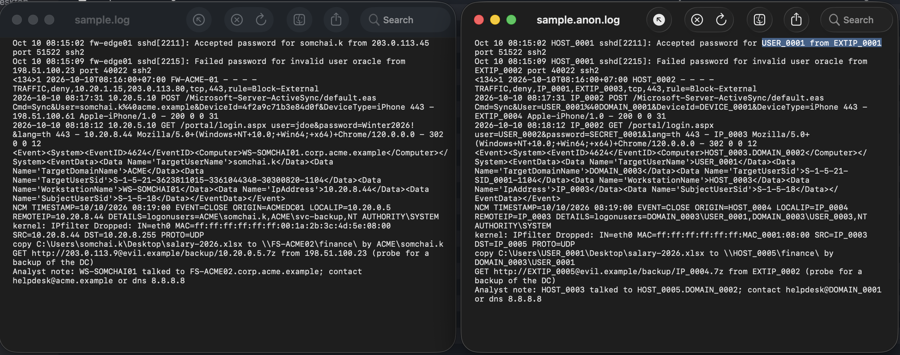
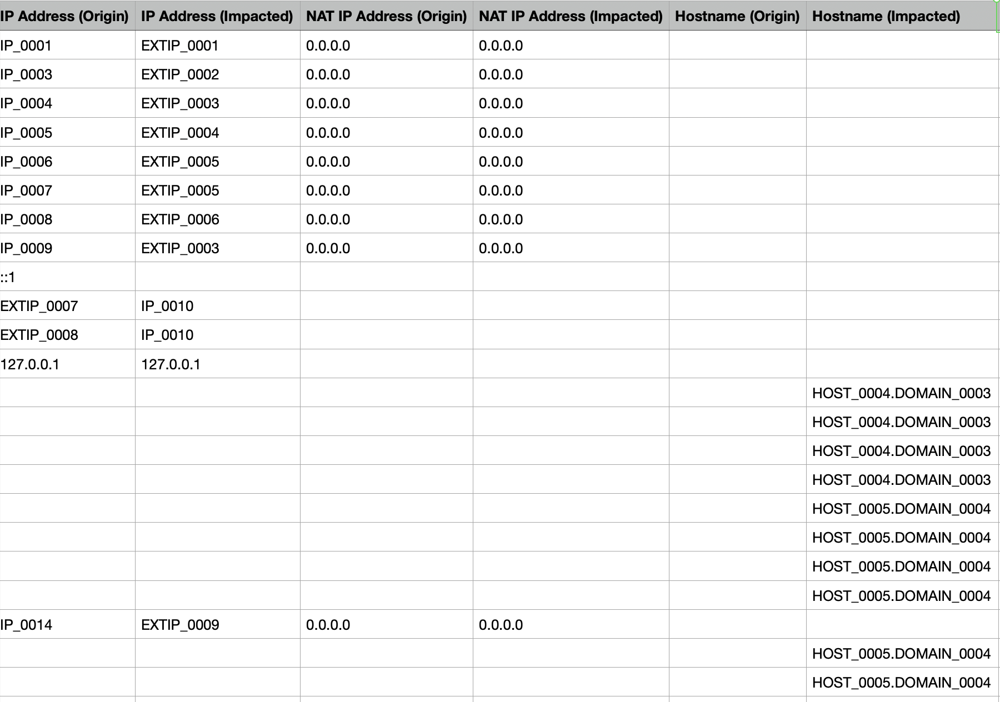

# Log Anonimizer

Replace IPs, hostnames, accounts, domains, e-mails, MACs, SIDs and secrets in logs with tokens
(`HOST_0001`, `USER_0003`, `IP_0012`) before sharing them. Restore the real values later with
the map file you keep.


- The map is encrypted (AES-256-GCM + Argon2id).
- Every run checks that no real value is left.

```
before:  Oct 10 08:15:02 fw-edge01 sshd[2211]: Accepted password for somchai.k from 203.0.113.45
after:   Oct 10 08:15:02 HOST_0001 sshd[2211]: Accepted password for USER_0001 from EXTIP_0001
```



## Install

### Download

Get the file for your system from the [latest release](https://github.com/finnvle/Log-Anonimizer/releases/latest):

| File | For |
|---|---|
| `log_anonimizer_<version>_windows_amd64.exe` | Windows 10/11, Server 2016+ |
| `log_anonimizer_<version>_windows_arm64.exe` | Windows on ARM |
| `log_anonimizer_<version>_linux_amd64` / `_linux_arm64` | Linux |
| `log_anonimizer_<version>_darwin_arm64` / `_darwin_amd64` | macOS Apple Silicon / Intel |

Rename it to `log_anonimizer` (`log_anonimizer.exe` on Windows). To check the download,
compare it with `SHA256SUMS` from the same release.

### Build from source

Needs [Go](https://go.dev/dl/) 1.26+:

```bash
git clone https://github.com/finnvle/Log-Anonimizer.git
cd Log-Anonimizer
go build -o log_anonimizer ./cmd/log_anonimizer   # this machine

# Build for all platforms into dist/
./scripts/build.sh
```
## TUI Usage (Easier)

```
./log_anonimizer
```


## CLI Usage

```
./log_anonimizer -h
./log_anonimizer -a export.csv    # anonymize  -> export.anon.csv + export.anonmap
./log_anonimizer -d export.anon.csv   # restore -> export.restored.csv
./log_anonimizer -show export.anon.csv    # which token is which real value
./log_anonimizer -verify export.anon.csv -m export.anonmap   # check before sharing
```

`-a` and `-d` also take a folder (e.g. a KAPE triage). `-d` works on any text with tokens,
such as a report you got back.

### Windows (PowerShell)

```powershell
Unblock-File .\log_anonimizer.exe          # if SmartScreen blocks it
.\log_anonimizer.exe -a export.csv -p acme
.\log_anonimizer.exe -d export.anon.csv
.\log_anonimizer.exe -show export.anon.csv
```

### Linux

```bash
chmod +x log_anonimizer
./log_anonimizer -a auth.log -p acme
./log_anonimizer -d auth.anon.log
```

### macOS

```bash
chmod +x log_anonimizer
xattr -d com.apple.quarantine log_anonimizer    # if Gatekeeper blocks it
./log_anonimizer -a export.csv -p acme
./log_anonimizer -d export.anon.csv
```

### Passphrase

You create a passphrase when the profile has `encrypt_map: true` (the default), or when you answer Yes in the TUI.

```
...
* Protect the map with a passphrase? Yes (recommended)
* Map passphrase ********
* Repeat passphrase ********
```

`-d`, `-show` and `-verify` ask for it again. If you forget it, the map cannot be opened.
For scripts only, where nobody can type, put it in the `LOGANON_PASSPHRASE` environment variable.

### Options

| Command | |
|---|---|
| *(nothing)* or `-i` | TUI wizard |
| `-a <file\|folder>` | anonymize |
| `-d <file\|folder>` | restore the real values (uses the map next to it, or `-m`) |
| `-show <map\|file\|folder>` | which token is which real value |
| `-verify <file\|folder>` | check anonymized output; add `-m` to look for every known value |


| Optional | |
|---|---|
| `-o <path>` | output file or folder (default: next to the input) |
| `-m <map>` | map to use; with `-a`, an existing map is extended (same tokens as before) |
| `-p <profile>` | profile name or `.yaml` file (default: `default`) |
| `-find <text>` | with `-show`: only matching tokens or values (also shows secrets) |
| `-f` | overwrite existing output and map |
| `-q` | no progress messages |
| `-no-encrypt` | plain map (not recommended) |
| `-profiles` | list saved profiles |
| `-print-profile` | print a profile with comments (add `-p` for another one) |
| `-version` | print the version |
| `-h` | help |

Exit codes: `0` ok, `1` error, `2` usage, `3` real values found in the output.

## Profiles

The first `-a` run creates **`default.yaml`**
and uses it whenever `-p` is not given, with a yellow warning:


The default replaces everything and encrypts the map. **Add your organisation's names to
`sensitive_terms`.** It is the one thing the tool cannot guess:

```yaml
sensitive_terms: [acme, acme.co.th]
anonymize:
  public_ip: false   # keep attackers' IPs as IOCs
```

Save an individual profile and run with `-p acme.yaml`.

You can run with `-print-profile` to prints all options with comments; `-profiles` lists saved profiles.

Profile folder: `%AppData%\log_anonimizer\profiles` (Windows),
`~/.config/log_anonimizer/profiles` (Linux), `~/Library/Application Support/log_anonimizer/profiles` (macOS).

## Example

[`examples/`](examples) is fictional data with [`profile.yaml`](examples/profile.yaml) (`sensitive_terms: [acme]`):

| File | |
|---|---|
| [`sample.log`](examples/sample.log) | input |
| [`sample.anon.log`](examples/sample.anon.log) | after `-a` |
| [`sample.restored.log`](examples/sample.restored.log) | after `-d`, identical to the input |
| [`show.txt`](examples/show.txt) | `-show sample.anon.log` |
| [`sample.anonmap`](examples/sample.anonmap) | the map, unencrypted only for the demo |

A LogRhythm CSV export after `-a`: addresses and hostnames become tokens, the columns stay as they were.




### Find from specific plaintext in map file

```
$ log_anonimizer -show sample.anon.log -find somchai
HOSTNAMES
  HOST_0003  WS-SOMCHAI01  3×
USERS
  USER_0001  somchai.k     6×
```

## What is replaced

| | Example | Token |
|---|---|---|
| IP (internal / public) | `10.1.2.3`, `203.0.113.5` | `IP_0001`, `EXTIP_0001` |
| Host, internal FQDN | `DC01`, `dc01.corp.acme.example` | `HOST_0001`, `HOST_0001.DOMAIN_0001` |
| Account, e-mail | `CORP\jdoe`, `jdoe@acme.example` | `DOMAIN_0002\USER_0001`, `USER_0001@DOMAIN_0003` |
| Path, share | `C:\Users\somchai\`, `\\FS01\share` | `C:\Users\USER_0002\`, `\\HOST_0002\share` |
| SID | `S-1-5-21-111-222-333-500` | `S-1-5-21-SID_0001-500` |
| MAC, device ID | `00:1a:2b:3c:4d:5e`, `DeviceId=…` | `MAC_0001`, `DEVICE_0001` |
| Secret | `password=`, `token=`, `Authorization:`, cookies | `SECRET_0001` |
| Sensitive term | `acme`, `ACMEDC01` | `ORG_0001`, `NAME_0001` |


**Input:** text logs, CSV (LogRhythm, EvtxECmd, …), IIS W3C, Windows event XML, syslog,
UTF-8/UTF-16, folders. Binary files (evtx, registry, `$MFT`) are skipped: convert them to CSV
first with EvtxECmd / RECmd / MFTECmd.

## The map

- `*.anonmap` turns tokens back into real values. **Never share it.**
- Encrypted with a passphrase by default; a wrong passphrase or an edited file is rejected.
- Reuse it with `-m` for later batches so tokens stay the same.

## Limits

- Detection is heuristic: check the `verify` line and skim the output before sharing.
- `DC01` and `dc01` share one token; `-d` restores the first spelling seen.

```bash
go test ./...
./scripts/build.sh
```

